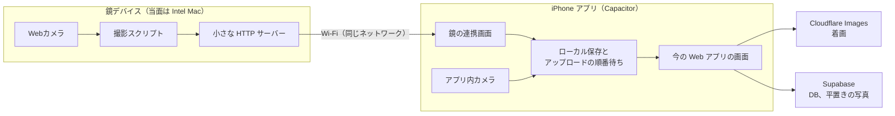

# プラン B：ネイティブアプリを GGA に間に合わせる計画

- 作成日：2026-10-31
- Issue：#6
- 決定者：marochanchan
- 状態：**レビュー前**
- 🤖 AI生成（Claude Code）

## 決めてほしいこと

今のプラン A（Web アプリのまま）を、プラン B（iPhone のネイティブアプリを GGA に間に合わせる）に切り替えるかを、**marochanchan さんが決めます**。この Issue は、その判断のための計画です。コーディングは AI が行うので、人に必要なのは環境の準備、設計の検討、実機での確認の時間です。

## 提案

- **方式は Capacitor：** 今の Vercel の Web アプリを iPhone アプリの殻で包み、カメラ、鏡との通信、ローカル保存だけをネイティブの機能で足します。
- **プラン A を捨てません：** Web アプリはそのまま使うので、11/3 の撮影と A の作業は B でも無駄になりません。
- **切り替えの判断は2つの関門のあとにします：** 関門 0 は開発環境の準備、関門 1 は半日の試作です。A はそのまま進めます。
- **最初の難所は Intel Mac です：** コードを書く前に、下の関門 0 を確かめてください。

## プラン A と B の違い

| | プラン A | プラン B |
|---|---|---|
| 発表で動くもの | Web アプリ | iPhone アプリ（画面は同じ Web アプリ） |
| 鏡からスマホへ | 手で送る（AirDrop など） | アプリの連携画面で受け取る |
| 平置きの撮影 | ブラウザから | アプリ内カメラ |
| 写真の保存 | そのままクラウドへ | 端末に保存し、順にアップロード |
| 発表での説明 | 構想として説明する | 動くものとして見せる |
| 追加の費用 | なし | Apple Developer Program 年99ドル |

## 構成

## 方式の比較

| 方式 | 今のコードとの相性 | 判断 |
|---|---|---|
| **Capacitor** | 26画面をそのまま使える。Server Actions と Cookie のログインがあるので静的書き出しはできず、Vercel を読み込む形になる | **おすすめ** |
| Expo / React Native | 画面の作り直しと、Server Actions に代わる API が必要になる見込み。AI が書けても、全画面の確認は人に残る | GGA のあとに再検討 |
| PWA | 鏡との通信とバックグラウンドの問題が残る見込み（未調査） | 採用しない |

## 作るもの

1. **アプリの殻：** Capacitor 8。`server.url` で Vercel を読み込みます。公式文書には「本番向けではない」とあるので、**発表用の構成**として扱います。
2. **アプリ内カメラ：** 平置きの撮影に使います。トリミングと明るさは Web の JavaScript で作り、A と B で共通にします。
3. **鏡の連携画面：** QR コードか IP アドレスで Mac とつなぎ、写真の一覧を見て取り込みます。
4. **鏡の側：** A の撮影スクリプトに、写真の一覧と取得ができる小さな HTTP サーバーを足します。
5. **ローカル保存とアップロードの順番待ち：** 最初はアプリを開いている間だけ送り、失敗したら送り直します。初期は全部クラウドに上げます。

## Webカメラと内蔵カメラ

ネイティブにすると、**内蔵カメラと鏡との通信**は扱いやすくなります。ただし、**iPhone に USB の Webカメラはつなげない見込み**です（Apple の担当者のフォーラムでの回答。iPad だけが対応）。Webカメラは鏡の側の Mac につないだままにします。

## Supabase の負荷

非同期にしても、Egress はあまり減らない見込みです。

- **着画：** すでにブラウザから Cloudflare へ直接送っていて、Supabase には行が増えるだけです。
- **平置きの写真：** Supabase Storage に置いています。
- **Egress：** Supabase から外へ出るデータの量です。アップロードが数えられるとは書かれていません。
- **減らす手段：** アプリ内の表示キャッシュと、平置きの写真の Cloudflare への移行が本命です。今回は順番待ちまでとし、移行は GGA のあとにします。

## 関門と日程

### 関門 0：開発環境（人。今日〜11/3）

- [ ] Apple Developer Program を購入する（Xcode 自体は無料で、購入するのはこちら）。確認に時間がかかることがあるので、**最初に行う**
- [ ] Intel Mac の macOS の版を確かめる（Xcode 26.2 と 26.3 は Sequoia 15.6 以上、26.5 以降は Tahoe 26.2 以上が必要）
- [ ] 空き容量を 40〜60GB にする（TODO の記録では約16GB。Xcode が入らない）
- [ ] Xcode 26.x を入れる（Xcode 27 は Apple シリコン専用のため、Intel Mac では使えない見込み）
- [ ] iPhone の機種と iOS の版を確かめる

**合格：** Intel Mac で作った空のアプリが、手元の iPhone で起動する。

### 関門 1：半日の試作（AI と人。11/4）

次の4つが実機で動くかを確かめます。

- [ ] 今の Web アプリが開き、ログインが続く
- [ ] 内蔵カメラで撮った写真が、今の登録の流れに乗る
- [ ] Mac の HTTP サーバーから写真を取得できる
- [ ] その写真を着画として送り、確定して線が出る

**11/4 に marochanchan さんが切り替えるかを決めます。**

### 実装（AI。人は確認。切り替えたときだけ）

| 日付 | 到達点 |
|---|---|
| 11/5 | アプリの殻を整える、アプリ内カメラ |
| 11/6 | 鏡の連携画面、鏡の側のサーバー |
| 11/7 | ローカル保存、順番待ち、送り直し |
| 11/8 | 実機で通しの確認、録画 |
| 11/9〜15 | 予備、リハーサル |

体制はプラン A と同じです（Opus がプラン、Sonnet のサブエージェントがコーディングとテスト、Codex がレビュー）。開発は marochanchan さんの Intel Mac で行います。

## 切り替えの基準

- **切り替える：** 関門 1 の4つがすべて動き、11/5〜8 に実機の確認の時間が取れる。
- **切り替えない：** どれかが動かない。A のまま発表します。失うのは、年99ドルと半日の試作です。
- **途中でやめる：** 11/8 の夜に iPhone で通しが動かなければ、A で発表します。

## 分かっている危険

| 危険 | 状況 | 対応 |
|---|---|---|
| Xcode 26.x で iOS 27 の iPhone に入れられるか | **未確認。最大の不安** | 関門 0 で最初に確かめる。だめなら、クラウドでビルドして TestFlight で入れる方法を調べる（未確認） |
| Intel Mac に Xcode 26.x が入らない | macOS の版と空き容量しだい | 関門 0 で確かめる |
| 鏡の HTTP が止められる | HTTPS の画面から `http://192.168.x.x` を読む形になる。ネイティブの通信で避けられるかは未確認 | 関門 1 で確かめる |
| App Store の審査 | Web サイトの包み直しは通らない可能性がある（Guideline 4.2） | GGA は実機か TestFlight で見せる。公開は別に検討する |
| Apple の登録待ち | 待ち時間の公式な目安はない。24時間で確認が来なければ問い合わせとある | 今日買う |
| バックグラウンドの送信 | 標準の Background Runner は1回約30秒で向かない | 初期はアプリを開いている間だけ。専用のプラグインは GGA のあとに試す |
| 会場の Wi-Fi | 端末どうしが通信できない可能性がある | 発表は録画で見せる |

## プラン A への影響

- **11/3 の撮影：** そのまま進めます。写真は B でも使います。
- **Plan 2a：** 続けます。Mac のブラウザで撮る機能なので、B の連携画面とは別のものです。
- **撮影スクリプト：** そのまま進めます。B では鏡の側の土台になります。
- **平置きのアプリ内カメラ：** トリミングと明るさは A と B で共通に作れます。撮る入口は、B に切り替えると作り直しになるので、関門 1 までは最小限にします。

## やらないこと

- App Store での公開
- Android 対応
- 完全なオフライン同期、バックグラウンドの確実な送信
- 署名の鍵を Repo に置くこと

## 出典（2026-10-31 に確認）

- Capacitor：[環境](https://capacitorjs.com/docs/getting-started/environment-setup)、[設定](https://capacitorjs.com/docs/config)、[Background Runner](https://capacitorjs.com/docs/apis/background-runner)
- Next.js：[静的書き出しの制限](https://nextjs.org/docs/app/guides/static-exports)
- Apple：[Xcode の要件](https://developer.apple.com/xcode/system-requirements/)、[Developer Program](https://developer.apple.com/programs/enroll/)、[登録](https://developer.apple.com/support/enrollment/)、[審査の指針](https://developer.apple.com/app-store/review/guidelines/)
- 二次情報：[Xcode 27 と Apple シリコン](https://developer.apple.com/forums/thread/829619)、[iPhone と外部カメラ](https://developer.apple.com/forums/thread/775883)、[Xcode の容量（第三者）](https://bitrise.io/blog/post/xcode-app-size-reduction-in-26-0-beta-5)
- Supabase：[Egress](https://supabase.com/docs/guides/platform/manage-your-usage/egress)

関連：#3、#4、#5
