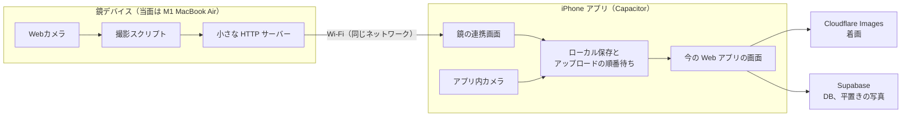

# プラン B：ネイティブアプリを GGA に間に合わせる計画

- 作成日：2026-10-31
- Issue：#6
- 決定者：marochanchan
- 状態：**関門 0 の途中**（2026-11-07 に日程を引き直し、appendix のおまけとして進める）
- 🤖 AI生成（Claude Code）

## 決めてほしいこと

今のプラン A（Web アプリのまま）を、プラン B（iPhone のネイティブアプリを GGA に間に合わせる）に切り替えるかを、**marochanchan さんが決めます**。この Issue は、その判断のための計画です。コーディングは AI が行うので、人に必要なのは環境の準備、設計の検討、実機での確認の時間です。

## 提案

- **方式は Capacitor：** 今の Vercel の Web アプリを iPhone アプリの殻で包み、カメラ、鏡との通信、ローカル保存だけをネイティブの機能で足します。
- **プラン A を捨てません：** Web アプリはそのまま使うので、11/3 の撮影と A の作業は B でも無駄になりません。
- **切り替えの判断は2つの関門のあとにします：** 関門 0 は開発環境の準備、関門 1 は半日の試作です。A はそのまま進めます。
- **開発機は M1 MacBook Air になりました（2026-11-03）：** Intel Mac の難所はなくなりました。コードを書く前に、下の関門 0 を確かめてください。

## プラン A と B の違い

| | プラン A | プラン B |
|---|---|---|
| 発表で動くもの | Web アプリ | iPhone アプリ（画面は同じ Web アプリ） |
| 鏡からスマホへ | 手で送る（AirDrop など） | アプリの連携画面で受け取る |
| 平置きの撮影 | ブラウザから | アプリ内カメラ |
| 写真の保存 | そのままクラウドへ | 端末に保存し、順にアップロード |
| 発表での説明 | 構想として説明する | 動くものとして見せる |
| 追加の費用 | なし | Apple Developer Program 年99ドル |

## 構成

## 方式の比較

| 方式 | 今のコードとの相性 | 判断 |
|---|---|---|
| **Capacitor** | 26画面をそのまま使える。Server Actions と Cookie のログインがあるので静的書き出しはできず、Vercel を読み込む形になる | **おすすめ** |
| Expo / React Native | 画面の作り直しと、Server Actions に代わる API が必要になる見込み。AI が書けても、全画面の確認は人に残る | GGA のあとに再検討 |
| PWA | 鏡との通信とバックグラウンドの問題が残る見込み（未調査） | 採用しない |

## 作るもの

1. **アプリの殻：** Capacitor 8。`server.url` で Vercel を読み込みます。公式文書には「本番向けではない」とあるので、**発表用の構成**として扱います。
2. **アプリ内カメラ：** 平置きの撮影に使います。トリミングと明るさは Web の JavaScript で作り、A と B で共通にします。
3. **鏡の連携画面：** QR コードか IP アドレスで Mac とつなぎ、写真の一覧を見て取り込みます。
4. **鏡の側：** A の撮影スクリプトに、写真の一覧と取得ができる小さな HTTP サーバーを足します。
5. **ローカル保存とアップロードの順番待ち：** 最初はアプリを開いている間だけ送り、失敗したら送り直します。初期は全部クラウドに上げます。

## Webカメラと内蔵カメラ

ネイティブにすると、**内蔵カメラと鏡との通信**は扱いやすくなります。ただし、**iPhone に USB の Webカメラはつなげない見込み**です（Apple の担当者のフォーラムでの回答。iPad だけが対応）。Webカメラは鏡の側の Mac につないだままにします。

## Supabase の負荷

非同期にしても、Egress はあまり減らない見込みです。

- **着画：** すでにブラウザから Cloudflare へ直接送っていて、Supabase には行が増えるだけです。
- **平置きの写真：** Supabase Storage に置いています。
- **Egress：** Supabase から外へ出るデータの量です。アップロードが数えられるとは書かれていません。
- **減らす手段：** アプリ内の表示キャッシュと、平置きの写真の Cloudflare への移行が本命です。今回は順番待ちまでとし、移行は GGA のあとにします。
- **送る画像を小さくする（Matthew のコメント）：** ネイティブアプリなら、Cloudflare の画像のサイズを落として小さくできます。新しい JPEG の形式で圧縮する手もあります。使える形式と画質は未確認です。

## 関門と日程

> **2026-11-07 に引き直しました。** 発表の本体はブラウザ（プラン A）のままです。プラン B は**発表の appendix に1枚入れるおまけ**として進めます。appendix の締めは **11/14（土）の夜**です。元の日程（11/4〜11/8）は使いません。

### 関門 0：開発環境（人と AI。11/7）

- [ ] Apple Developer Program を購入する → **まだ買いません。** まず無料の Apple ID で試し、関門 0 を通ってから判断します（下の「Developer Program の判断」）
- [x] M1 MacBook Air の macOS の版を確かめる（macOS 27.2、2026-11-03 に確認）
- [x] 空き容量を 40〜60GB にする（約 830GB、2026-11-03 に確認）
- [x] Xcode を入れる（Xcode 27.2、build 27B52。2026-11-07 に確認）
- [x] iPhone の iOS の版を確かめる（iOS 27.2）
- [x] Capacitor の殻を作る（`mobile/`。Capacitor 8.6.0、Swift Package Manager、`server.url` で本番を読む）
- [x] シミュレーター（iPhone 18 Pro、iOS 27.2）で起動し、本番の画面が出る（2026-11-07）
- [ ] 手元の iPhone に無料の Apple ID で入れて起動する

**合格：** M1 MacBook Air で作った空のアプリが、手元の iPhone で起動する。

### 関門 1：試作（AI と人。11/8〜11/9）

上から順に、実機で動くかを確かめます。appendix には、11/12 までに動いたところまでを載せます。

- [ ] 今の Web アプリが開き、ログインが続く（アプリを閉じて開き直してもログインしたまま）
- [ ] 内蔵カメラで撮った写真が、今の登録の流れに乗る
- [ ] Mac の HTTP サーバーから写真を取得できる
- [ ] その写真を着画として送り、確定して線が出る

### 日程（11/7〜11/16）

| 日付 | すること | 人の作業 |
|---|---|---|
| 11/7（土） | 関門 0：殻を実機で起動する | Xcode に Apple ID を登録、iPhone の開発者モード、信頼の設定 |
| 11/8（日） | Developer Program を判断する。関門 1 の前半（ログイン、内蔵カメラ） | 実機でログインと撮影を試す |
| 11/9（月） | 関門 1 の後半（鏡の HTTP、着画を送る）。夜に appendix に載せる範囲を決める | 同じ Wi-Fi で Mac と iPhone を試す |
| 11/10（火） | **練習の日。B は触りません** | 練習 |
| 11/11（水）〜11/12（木） | 見せる流れを1本にまとめ、実機で録画する。12日に入れ直すと、無料の署名が 11/19 まで持つ | 録画 |
| 11/13（金） | appendix の1枚（画面写真か短い動画）を作る | 確認 |
| **11/14（土）夜** | **締め。** 入らなければ appendix から外す | 判断 |
| 11/15（日） | 予備。B は触りません | — |
| 11/16（月） | 発表 | — |

体制はプラン A と同じです（Opus がプラン、Sonnet のサブエージェントがコーディングとテスト、Codex がレビュー）。開発は marochanchan さんの M1 MacBook Air で行います。

### Developer Program の判断（11/8）

appendix だけなら、**無料の Apple ID で足りる見込み**です。

| | 無料の Apple ID | Developer Program（年99ドル） |
|---|---|---|
| 自分の iPhone で動かす | できる | できる |
| 署名の期限 | 7日（切れたら Mac から入れ直す） | 1年 |
| 入れられるアプリ | 1台に3つまで | 制限なし |
| TestFlight で人に配る | できない | できる |
| 審査の待ち | なし | 登録の確認に時間がかかることがある |

- **買わない（おすすめ）：** appendix は画面写真か録画なので、7日の期限は問題になりません。
- **買う：** 発表の前に、人の iPhone に TestFlight で配りたいとき。または GGA のあともプラン B を続けると決めたとき。

## appendix の基準

- **載せる：** 関門 1 のうち、11/12 までに実機で動いたところまで。殻だけでも「同じ Web アプリがそのまま iPhone アプリになる」と見せられます。
- **外す：** 11/14 の夜に、実機で起動する画面写真か録画がそろっていないとき。
- **触らない日：** 11/10 と 11/15 は練習と予備に使い、B の作業はしません。

## 分かっている危険

| 危険 | 状況 | 対応 |
|---|---|---|
| 手元の Xcode で iOS 27 の iPhone に入れられるか | Xcode 27.2 でシミュレーター（iOS 27.2）のビルドと起動は確認済み（11/7）。実機は未確認 | 関門 0 で確かめる |
| 鏡の HTTP が止められる | HTTPS の画面から `http://192.168.x.x` を読む形になる。ネイティブの通信で避けられるかは未確認 | 関門 1 で確かめる |
| App Store の審査 | Web サイトの包み直しは通らない可能性がある（Guideline 4.2） | GGA は実機か TestFlight で見せる。公開は別に検討する |
| Apple の登録待ち | 待ち時間の公式な目安はない。24時間で確認が来なければ問い合わせとある | 無料の Apple ID で始めるので、待ちは日程に響かない。買うなら 11/8 に |
| 無料の Apple ID の制限 | 署名は7日で切れ、1台に3つまで | 11/12 に入れ直せば 11/19 まで持つ |
| 初回起動の白い画面 | シミュレーターの起動直後は、本番の読み込みが30秒で時間切れになり白いままだった。開き直すと出た | 実機で再現するかを関門 0 で見る |
| バックグラウンドの送信 | 標準の Background Runner は1回約30秒で向かない | 初期はアプリを開いている間だけ。専用のプラグインは GGA のあとに試す |
| 会場の Wi-Fi | 端末どうしが通信できない可能性がある | 発表は録画で見せる |

## プラン A への影響

- **11/3 の撮影：** そのまま進めます。写真は B でも使います。
- **Plan 2a：** 続けます。Mac のブラウザで撮る機能なので、B の連携画面とは別のものです。
- **撮影スクリプト：** そのまま進めます。B では鏡の側の土台になります。
- **平置きのアプリ内カメラ：** トリミングと明るさは A と B で共通に作れます。撮る入口は、B に切り替えると作り直しになるので、関門 1 までは最小限にします。

## やらないこと

- App Store での公開
- Android 対応
- 完全なオフライン同期、バックグラウンドの確実な送信
- 署名の鍵を Repo に置くこと

## 出典（2026-10-31 に確認）

- Capacitor：[環境](https://capacitorjs.com/docs/getting-started/environment-setup)、[設定](https://capacitorjs.com/docs/config)、[Background Runner](https://capacitorjs.com/docs/apis/background-runner)
- Next.js：[静的書き出しの制限](https://nextjs.org/docs/app/guides/static-exports)
- Apple：[Xcode の要件](https://developer.apple.com/xcode/system-requirements/)、[Developer Program](https://developer.apple.com/programs/enroll/)、[登録](https://developer.apple.com/support/enrollment/)、[審査の指針](https://developer.apple.com/app-store/review/guidelines/)
- 二次情報：[Xcode 27 と Apple シリコン](https://developer.apple.com/forums/thread/829619)、[iPhone と外部カメラ](https://developer.apple.com/forums/thread/775883)、[Xcode の容量（第三者）](https://bitrise.io/blog/post/xcode-app-size-reduction-in-26-0-beta-5)
- Supabase：[Egress](https://supabase.com/docs/guides/platform/manage-your-usage/egress)

関連：#3、#4、#5
