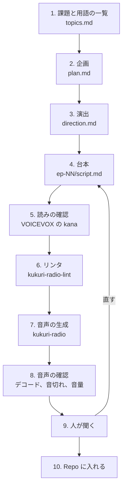

# ラジオの作り方

資料や Issue から、2人の対話のラジオ（MP3）を作る手順です。コマンドは Repo のルートから実行します。

🤖 AI生成（Claude Code）。

## 全体の流れ



## 必要なもの

- [VOICEVOX](https://voicevox.hiroshiba.jp/)（起動しておく。`http://127.0.0.1:50021` で動く）
- `ffmpeg`、`ffprobe`
- Python 3
- 動作を確認した環境：macOS、VOICEVOX 0.26.0

起動しているかは、次で分かります。

```sh
curl -s http://127.0.0.1:50021/version
```

## ファイルの置き場所

```text
docs/radio/
├── README.md                       聴く順番、クレジット
├── how-to-make.md                  このファイル
├── tools/
│   ├── kukuri-radio                音声の生成（台本 → MP3）
│   └── kukuri-radio-lint           台本のリンタ
└── 2026-10-31-tech-series/         シリーズごとのフォルダー
    ├── topics.md                   課題と用語の一覧
    ├── plan.md                     企画と根拠資料
    ├── direction.md                演出と読みの決まり
    ├── ep-01/
    │   ├── script.md               台本
    │   └── recloset-tech-ep01.mp3  完成した音声
    └── ep-02/ …
```

`docs/radio/_render/` は生成の作業場所で、Git に入りません（`docs/radio/.gitignore`）。

## 手順

### 1. 課題と用語の一覧（`topics.md`）

Repo の文書、Issue、PR を読んで、課題と用語を並べます。Repo にない語には【追加】と付け、確かめた事実と分けます。

### 2. 企画（`plan.md`）

テーマ、聴き手、目的、形式、話ごとの構成、根拠資料を書きます。価格など動く数字には、確認した日と出典を書きます。

### 3. 演出（`direction.md`）

話者の役割、話の進め方、演出の記号、読みの決まりを書きます。

### 4. 台本（`ep-NN/script.md`）

1話を1ファイルにします。形式は次のとおりです。

```markdown
# 第1話 題名

## 章の名前

**松尾悠人**:（穏やか）「解説の台詞です。」

**桜井ひなた**:（考え）「質問の台詞です。」
```

- 話者は `松尾悠人` と `桜井ひなた` の2人だけです。ほかの名前だとリンタで止まります
- `## 章` の間に、0.8秒の間が入ります（章の名前は読み上げません）
- 話者が替わると、0.4秒の間が入ります
- 演出は `「」` の外の左に書きます。`「」` の中に `（笑）` のように書けません
- 1発話は200字までです
- 数字は漢数字で書きます（例：`十一月三日`、`二万円`）
- 英語はカタカナで書きます（`direction.md` の表）

### 5. 読みの確認

**ここが一番大事です。** VOICEVOX の読みは、音を作る前に文字で確かめられます。単語だけでなく、**文の形で**確かめてください。文の中で読みが変わることがあります。

```sh
curl -s -X POST -G http://127.0.0.1:50021/audio_query \
  --data-urlencode "speaker=11" \
  --data-urlencode "text=二本目は着画です" | python3 -c "import json,sys; print(json.load(sys.stdin)['kana'])"
```

読みが違っていたら、台本をひらがなで書き直します（例：`平置き` → `ひらおき`）。

### 6. リンタ

```sh
python3 docs/radio/tools/kukuri-radio-lint docs/radio/2026-10-31-tech-series/ep-*/script.md
```

記法、空の発話、長さ、演出の位置を確かめます。**合格しても、内容、発音、音質の合格ではありません。** 推定の尺も出ます（320字で1分の換算）。今回の話者の設定では、実際は1分あたり約360字でした。

### 7. 音声の生成

```sh
python3 docs/radio/tools/kukuri-radio 1 \
  --source docs/radio/2026-10-31-tech-series \
  --output docs/radio/_render/ep01
```

- `1` は話の番号です。`--source` の下の `ep-01/script.md` を読みます
- `--output` は `docs/radio/` の下の、まだないフォルダーです。あると止まります
- 発話が1つでも作れなければ、MP3 を作らずに止まります
- 接続先は `127.0.0.1:50021` だけです
- 出力は `aidev-ep01.mp3`、`production.json`（設定と全発話の記録）、`queries/`、`segments/` です

話者と話し方の設定は次のとおりです（`tools/kukuri-radio` の先頭）。

| 話者 | 役割 | 声 | speedScale | intonationScale |
|---|---|---|---|---|
| 松尾悠人 | 解説 | 玄野武宏 ノーマル（ID 11） | 1.00 | 1.05 |
| 桜井ひなた | 質問 | 四国めたん ノーマル（ID 2） | 1.07 | 1.20 |

演出の記号によって、この値に倍率が掛かります（例：`真剣` は速さ 0.93 倍）。

### 8. 音声の確認

```sh
f=docs/radio/_render/ep01/aidev-ep01.mp3
ffprobe -v error -show_entries format=duration -of csv=p=0 "$f"   # 長さ
ffmpeg -v error -i "$f" -f null -                                 # デコードのエラー（何も出なければ正常）
ffmpeg -i "$f" -af silencedetect=noise=-40dB:d=2 -f null - 2>&1 | grep silence_start   # 2秒以上の無音（音切れの候補）
ffmpeg -i "$f" -af volumedetect -f null - 2>&1 | grep -E 'mean_volume|max_volume'     # 音量
```

あわせて、`production.json` の `speeches` がリンタの発話数と同じことを確かめます。

### 9. 人が聞く

機械の確認では、読み間違い、不自然な間、内容の誤りは分かりません。**必ず人が聞きます。** 直すときは台本を直して、手順5からやり直します。

### 10. Repo に入れる

MP3 に題名とクレジットを入れて、話のフォルダーへ置きます。

```sh
ffmpeg -i docs/radio/_render/ep01/aidev-ep01.mp3 -c copy \
  -metadata title="リクローゼット技術ラジオ 第1話" \
  -metadata comment="VOICEVOX:玄野武宏 / VOICEVOX:四国めたん" \
  docs/radio/2026-10-31-tech-series/ep-01/recloset-tech-ep01.mp3
```

公開 Repo に push すると、誰でも聞けます。秘密の値や、公開しない話が入っていないことを確かめてください。MP3 は1話で約7MB あり、Git の履歴に残り続けます。作り直しは必要なときだけにします。

## クレジット

VOICEVOX の音声を公開するときは、クレジットが必要です。形式は `VOICEVOX:玄野武宏`、`VOICEVOX:四国めたん` です。規約は [VOICEVOX](https://voicevox.hiroshiba.jp/term/) と各音声ライブラリの案内を確かめてください。
