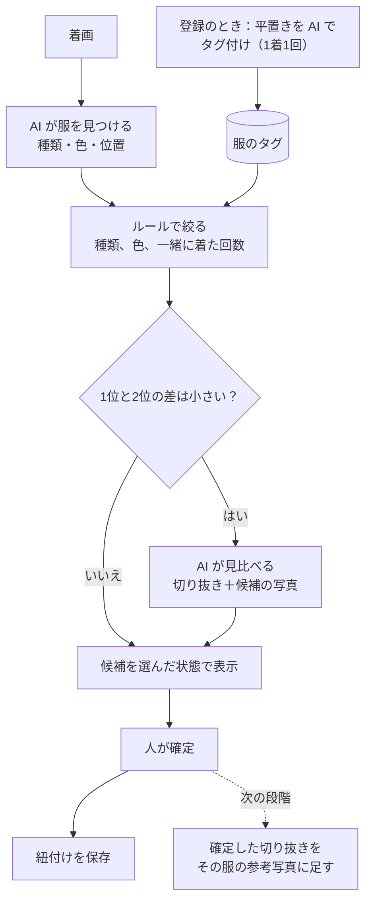

# 服の画像の類似判定：調査レポート

- 調査日：2026-10-31
- Issue：#5
- 読みやすい説明：[`explainer.html`](./explainer.html)
- 🤖 AI生成（Claude Code）。実際の写真での試験はまだしていません。

## 結論

**「タグで絞って、AI が見比べて、人が確定する」方式を推薦します。** 仕様書 7.5 章の案を小さく始める形です。

- **費用：** 着画1枚で約0.005〜0.013ドル（1ドル150円で約1〜2円）。1人で使うなら月に約25〜60円です（試算）。
- **作る量：** 新しいサーバーもベクトル検索も要りません。今の Gemini の呼び出しと DB の項目を使えます。
- **理由：** 新しい基盤も月額の固定費もなしに、似た服と隠れた服まで試せます。
- **弱点：** 服の照合での精度を示す公開データは見つかりませんでした。ほかの方式より当たるという証拠もありません。これは「今の構成で先に試す案」です。**撮った写真での試験が必須です。**

次点は「切り抜き＋画像の埋め込み」です。利用者が増えたときの費用を下げる次の段階として使います。

## 解く問題

登録済みの平置きの写真と、鏡の前の全身写真（着画）を結びつけます。1人の持ち服は100着程度を想定します。候補を出して人が直すので、完全な自動判定は目指しません。

難しいところは3つです。

1. **見え方の違い：** 同じ服でも、平置きと着用では形が変わります。
2. **似た服：** 白シャツと白ブラウスなど。
3. **隠れた服：** ジャケットの下のシャツなど。

## 候補の比較

費用は1回あたりの試算です。前提は「費用の試算」の節にあります。

| 候補 | 得意 | 苦手 | 精度の手がかり | 費用 | 手間 |
|---|---|---|---|---|---|
| **A. メタデータ** | 候補を安く絞る | 似た服（重ね着も苦手と推測） | 属性の判定は全体の F1 で43〜64%（論文。照合の正解率ではない） | 登録1着 約 $0.0012 | 小 |
| **B. 切り抜き＋色**（OpenCV） | 無料、どこでも動く | 似た服、隠れた服、照明の変化 | 公開データなし | $0 | 小 |
| **C. 領域分割＋埋め込み** | 大量の服を安く検索 | 見え方の違い、切り抜きの精度に左右される | DeepFashion2 で上位1件 約60%（追加学習あり、二次情報） | 1画像 $0.00012〜 | 中 |
| **D. AI で直接比べる** | 似た服の最後の判断（期待で、未検証） | 枚数が増えると費用が増える | 服での評価は見つからず。人物の照合では大きく外す例の報告あり | 1回 約 $0.0009〜0.0024 | 小 |
| **E. 履歴で絞る** | 同点の順位を決める | 単独では使えない | 服の識別での評価は見つからず | $0 | 小 |
| **F. 商用 API** | 作らずに済む、少人数なら安い | 利用者が増えると高い、データを外に預ける | 公開データなし | 月 約 $950〜1,079（1,000人で服4着ずつの場合） | 小 |

### 候補ごとの補足

**A. メタデータ。** 今の解析（`lib/clothing-image-analysis.ts`）は、種類、色、柄、素材感など17項目を返します。登録画面で使うのはタイトル、カテゴリー、種類、色、季節などで、柄や素材感は保存していません（migration 013 が足した列は `subcategory` と `main_color`）。識別には粗いので、絞り込みに使います。論文では、着ている人の写真の属性判定で Gemini 2.0 Flash が macro-F1 56.8%、GPT-4o-mini が 43.3% でした（arXiv 2507.09950）。別の研究では、全体の macro-F1 が 64.0% で、属性が当てはまるかどうかの判定は F1 34.1% と低く、当てはまると分かった後の細かい判定は 70.8% でした（arXiv 2601.15711）。これらは属性の判定の点数で、服の照合の正解率ではありません。重ね着に弱いというのは、この結果からの推測です。

**B. 切り抜き＋色。** GrabCut や色のヒストグラムは無料です。ただ、白シャツと白ブラウスは色で分けられません。知覚ハッシュは写真のレイアウトに左右されるので、平置きと着用の比較には向きません。姿勢推定（MediaPipe など）で体の範囲を切るのは、安い改善になりそうです（未検証）。

**C. 領域分割＋埋め込み。** 商用で使えるモデルの例は次のとおりです。

- 領域分割：`mattmdjaga/segformer_b2_clothes`（MIT）、SAM 2.1（Apache-2.0）
- 埋め込み：Marqo-FashionSigLIP（Apache-2.0）、Gemini Embedding 2（1画像 $0.00012）
- 注意：Ultralytics の YOLO は AGPL-3.0 です。使うならライセンスの確認が必要です。`jina-clip-v2` は非商用です。

Vercel の関数の標準のサイズ上限は 250MB（Python は 500MB）です。5GB まで使えるベータ機能もありますが、モデルを自分で動かすなら、別の置き場所も検討が要ります。100着なら索引は不要で、全件を比べれば足ります。768次元のベクトルは1本 3,080 バイトで、1,000人×100着だと 308MB です。

**D. AI で直接比べる。** 切り抜き1枚と候補5枚なら、どの会社の画像枚数の上限にも収まります。服で評価した信頼できる結果は見つかりませんでした。人物の照合の研究には、大きく外すことがあるという報告があります（arXiv 2501.18698）。そのため、人の確認を前提にします。

**F. 商用 API。** Ximilar は服に特化しています。標準の検索は写真の中で一番大きい服だけを対象にするので、服ごとに探すには検出と、服ごとの検索が要ります。少人数で試すなら候補になりますが、利用者が増えると高くなります。プランと価格の対応はページの並びから読んだものです。Google の Product Search は保守モード、AWS の Custom Labels は常時動かすと月約 $2,900 で、向きません。

### 既存のアプリ

Acloset は全身写真から服を自動で見つけて、それぞれを新しい服として登録すると説明しています。**写真を登録済みの服と照合するアプリは、確認できた範囲では見つかりませんでした。** 多くは人が服を選びます。候補を出して人が確定する形は、利用者にとって自然です。ただし、これは「見つからなかった」という意味で、「存在しない」とは言えません。

## 推薦の方式

推薦する理由は次のとおりです。

- **今あるものを使えます。** Gemini の呼び出し、Cloudflare の画像、服の項目はそろっています。
- **費用の高い処理を減らせます。** 最初に絞るので、見比べは迷うときだけで済みます。
- **部品を差し替えられます。** 見比べを、あとで埋め込みや端末内の処理に替えられます。
- **弱点を人が補います。** 外れても、人が直せば記録は正しくなります。

### 最初に確かめること

`gemini-3.5-flash-lite` が服の位置（枠）を返せるかは、公式の文書で確認できませんでした。文書の例は `gemini-3.8-flash` です。動かなければ、検出だけ `gemini-3.8-flash` を使います。

もう一つは見比べの画質です。低い設定は安くなりますが、似た服の細かい違いが読めなくなるかもしれません。

## 費用の試算

価格はいずれも 2026-10-31 に確認しました。

- `gemini-3.5-flash-lite`：入力 $0.30、出力 $2.50（100万トークンあたり）
- `gemini-3.8-flash`：入力 $0.75、出力 $3.75（2026年末まで。2027年から2倍）
- Gemini Embedding 2：1画像 $0.00012
- Vercel AI Gateway：上乗せなし
- 画像のトークン（Gemini 3 系）：標準と高は1枚 1,120、低は 280

**文章と出力のトークン数は私の仮定です。** `gemini-3.5-flash-lite` に上の画像の設定がそのまま当てはまるかは、公式の文書に明記がありません。隠れた「考える」トークンが出ると、費用は上がります。

| 処理 | 入力 | 出力 | Flash-Lite | 3.8 Flash |
|---|---|---|---|---|
| 平置きのタグ付け（画像は標準） | 1,420 | 300 | $0.0012 | - |
| 着画の検出（画像は標準） | 1,520 | 600 | $0.0020 | $0.0034 |
| 見比べ（6枚、画像は低） | 2,080 | 100 | $0.0009 | - |
| 見比べ（6枚、画像は標準） | 7,120 | 100 | $0.0024 | - |

**着画1枚（服4着、全部を見比べた場合）**

| 検出 | 見比べ | 1枚 | 1人の月額（30枚） | 1,000人の月額（30,000枚） |
|---|---|---|---|---|
| Flash-Lite | 低 | 約 $0.0055（約0.8円） | 約 $0.16（約25円） | 約 $164（約25,000円） |
| Flash-Lite | 標準 | 約 $0.0115（約1.7円） | 約 $0.35（約52円） | 約 $345（約52,000円） |
| 3.8 Flash | 標準 | 約 $0.0129（約1.9円） | 約 $0.39（約58円） | 約 $388（約58,000円） |
| Flash-Lite | 埋め込みに替える | 約 $0.0024（約0.4円） | 約 $0.07（約11円） | 約 $73（約11,000円） |

見比べは迷うときだけなので、実際はこれより減る見込みです。見比べはどの行も Flash-Lite で計算しました。

**商用 API（Ximilar）との比較**

服4着を探すなら、1枚で検出5クレジット＋検索10クレジット×4＝45クレジットです（服ごとの検索も10クレジットと仮定）。

- 1人：月1,350クレジットで、無料枠の1,000を超えます。追加クレジット（10,000で $11、有効期限なし）で足りるので、少人数で試すなら安く始められます。月額プランなら $69 です。
- 1,000人：月1,350,000クレジットです。200万クレジットのプランで月 $1,079（約162,000円）、100万クレジットのプランと追加クレジットの組み合わせで月 約 $950（約142,000円）です。
- 一番大きい服だけなら、1,000人で月300,000クレジット、月 $199 です。ただし、服4着は当てられません。
- 服の登録も1枚10クレジットかかります（1,000人×100着で1,000,000クレジット）。

**登録の費用（1回だけ）**

- 100着で約 $0.12（約18円）
- 1,000人×100着で約 $118（約18,000円）。埋め込みを足すと、約 $12 増えます。

**入れていないもの：** 画像と DB の保存料、今の Cloudflare の月額です。円は1ドル150円で計算しました。

### Supabase の転送量（Egress）

Free プランの Egress には余裕がありません（`docs/project/TODO.md`）。見比べでは、平置きの写真を候補の数だけ取り出します。

- 服4着×候補5枚で、着画1枚につき20枚を取り出します。
- 今の平置きは長辺 1600px です。仮に1枚300KB なら、着画1枚で約6MB、1人の月で約180MB です。1,000人なら約180GB です。
- 見比べ用の小さな写真（長辺384px、仮に1枚30KB）を登録のときに作って使い回せば、1/10になります。

発表までは枚数が少ないので影響は小さい見込みです。11/3 の試験は手元のファイルで行えば、Egress を使いません。利用者を増やす前に、小さな写真か、平置きの Cloudflare への移行が必要です。

## 発表で説明する計画

**3段階で進めます。**

1. **今：** タグで絞り、AI が見比べ、人が確定します。1枚およそ1〜2円で、新しい基盤は要りません。
2. **利用者が増えたら：** 画像の埋め込みを足して、AI の呼び出しを減らします。確定した写真を参考に足して、その人の服に合わせて当たりやすくします（狙いで、未検証です）。
3. **スマホ中心の構成では：** 処理を端末に移して、クラウドの費用と写真を外へ送る量を減らします（未検証です）。

**30秒の説明の例**

> 着画に写っている服を、登録した服と結びつけます。まず AI が服の種類と色を読み取って候補を絞り、迷うときだけ写真を見比べます。最後は人が確定します。1枚およそ1〜2円で動く見込みです。確定が増えるほど、その人の服の写真が貯まっていきます。

実装を発表に入れない場合は、最初に「これは計画です」と添えてください。

## 11/3 に実装すると決めた場合

見込みです。AI がコードを書き、人は確認します。

| 範囲 | 内容 | 作業量 | DB の変更 |
|---|---|---|---|
| 試験用スクリプト | 下の試験を実行するだけ | 数時間 | なし |
| 発表用の最小版 | 今の記録画面で、写真を送ったあと、候補を選んだ状態で服の選択画面に出す。確定は今の `confirm_outfit` のまま。記録は手で選んだ扱い（`manual`）になり、解析の履歴、枠、参考写真の保存は含まない | 半日〜1日 | なし |
| 正式版 | 仕様書 7.5 章の解析テーブル、枠の表示、やり直し | 数日。本番適用も別に必要 | あり |

正式版は GGA のあとをおすすめします。Plan 1 では、本番への切り替えに 10/27〜10/31 までかかりました。

## 11/3 の写真での試験

**用意するもの**

- 着画：4〜5コーデ、各2枚。仮の5コーデなら、服は延べ19着で、試行は38回です。
- 平置き：8着と、似た服1着。
- 妨害用の候補：9着では簡単すぎるので、手持ちの服の写真を混ぜて30着程度にします。

**手順**

1. 人が正解表を作ります（どの着画に、どの服が写っているか）。
2. 平置きをすべてタグ付けします。
3. 着画ごとに、AI が服を見つけます。
4. 次の方式で順位を出します。
   - タグだけ
   - タグ＋AI の見比べ
   - 埋め込み（Gemini Embedding 2）
   - 余裕があれば、切り抜き＋色
5. 同じ流れで、検出のモデルも比べます（`gemini-3.5-flash-lite` と `gemini-3.8-flash`）。
6. 見比べの画質も比べます（低と標準）。

**測るもの**

- 服を見つけられた割合
- 上位1件と上位3件の正解率
- 似た服と隠れた服だけの正解率
- 1枚あたりの費用と時間

費用は全部で約 $0.26（約40円）の見込みです。内訳は、平置き30着のタグ付け、検出2モデル×着画10枚、見比べ、埋め込み106枚です。見比べはすべて Flash-Lite で、検出2モデルの結果それぞれに低、片方の結果に標準を試します（試算）。試行が少ないので、結果は傾向として読みます。

**判断の案**

- 上位3件の正解率が8割以上なら、発表で動かします。
- 届かなければ、発表は手作業のままにして、計画として説明します。

この基準は私の案です。実際の写真を見て決めてください。

## プライバシー

着画は、家の中の全身写真です。

- **有料枠だけを使います。** Gemini API の無料枠は「製品の改善に使う」、有料枠は「使わない」と公式の料金ページにあります。今の AI Gateway の経路がどちらの扱いになるかは未確認なので、実装の前に確かめてください。
- **保存期間：** OpenAI と Anthropic の API は最大30日と案内しています。Gemini の有料枠は「限られた期間」で、日数は公式の規約で確認できませんでした。
- **送る範囲を減らします。** できれば顔を外し、首から下だけを送ります。切り抜きだけで済む処理は切り抜きを送ります。
- **利用者に伝えます。** 一般公開の前に、どの会社へ写真を送るかの説明、同意、削除の手段を用意します。
- **個人情報保護法：** 一次情報を確認できませんでした。公開の前に確かめてください。

## 分かっていないこと

- 平置きと着用の照合での、実際の精度
- `gemini-3.5-flash-lite` の枠の検出の精度と、そもそも対応しているか
- `gemini-3.5-flash-lite` の画像のトークン数が、Gemini 3 系の表のとおりか
- 見比べの画質を低くしても、似た服を見分けられるか
- 隠れた「考える」トークンの費用
- 端末内の処理（Apple Vision、Core ML）で実用になるか
- 確定した写真を足すことで、どれだけ当たりやすくなるか
- 照合まで行う既存のアプリが本当にないか

## 出典

確認日はすべて 2026-10-31 です。

**公式**

- [Gemini API の料金](https://ai.google.dev/gemini-api/docs/pricing)（2026-10-30 更新）
- [Gemini の画像理解](https://ai.google.dev/gemini-api/docs/image-understanding)（2026-09-23 更新）
- [Gemini の画像の解像度設定](https://ai.google.dev/gemini-api/docs/media-resolution)（2026-10-13 更新）
- [Vercel AI Gateway の料金](https://vercel.com/docs/ai-gateway/pricing)（2026-09-08 更新）
- [Ximilar の料金](https://www.ximilar.com/pricing/)、[服の画像検索](https://docs.ximilar.com/visual-search/fashion)
- [Google Product Search](https://docs.cloud.google.com/vision/product-search/docs)
- [AWS Rekognition の料金](https://aws.amazon.com/rekognition/pricing/)
- [pgvector](https://github.com/pgvector/pgvector)
- [Vercel の関数の上限](https://vercel.com/docs/functions/limitations)
- [SAM 2](https://github.com/facebookresearch/sam2)
- [Ultralytics のライセンス](https://ultralytics.com/license)
- [Marqo-FashionSigLIP](https://huggingface.co/Marqo/marqo-fashionSigLIP)
- [Acloset のサポート](https://www.acloset.app/support/)（会社の説明）
- [OpenAI のデータの扱い](https://developers.openai.com/api/docs/guides/your-data)
- [Anthropic のデータの保存](https://privacy.claude.com/en/articles/7996866-how-long-do-you-store-my-organization-s-data)

**論文**

- [arXiv 2507.09950](https://arxiv.org/html/2507.09950v2)：服の属性の判定
- [arXiv 2601.15711](https://arxiv.org/abs/2601.15711)：9モデルの属性の判定
- [arXiv 2601.14706](https://arxiv.org/abs/2601.14706)：LookBench
- [arXiv 1901.07973](https://arxiv.org/pdf/1901.07973)：DeepFashion2
- [arXiv 2501.18698](https://arxiv.org/abs/2501.18698)：大規模言語モデルと人物の照合
- [ICCV 2015](https://openaccess.thecvf.com/content_iccv_2015/papers/Kiapour_Where_to_Buy_ICCV_2015_paper.pdf)：Where to Buy It

**二次情報（確かさは低い）**

- [DeepFashion2 での埋め込みの比較](https://hopitai.substack.com/p/beating-fashionsiglip)
- [`mattmdjaga/segformer_b2_clothes`](https://huggingface.co/mattmdjaga/segformer_b2_clothes)（数値はモデルカードの要約から）
- [Indyx と Whering の比較](https://myindyx.com/versus/whering-vs-indyx)（競合の説明）
